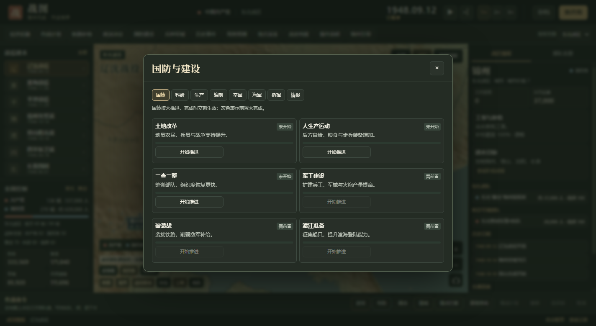
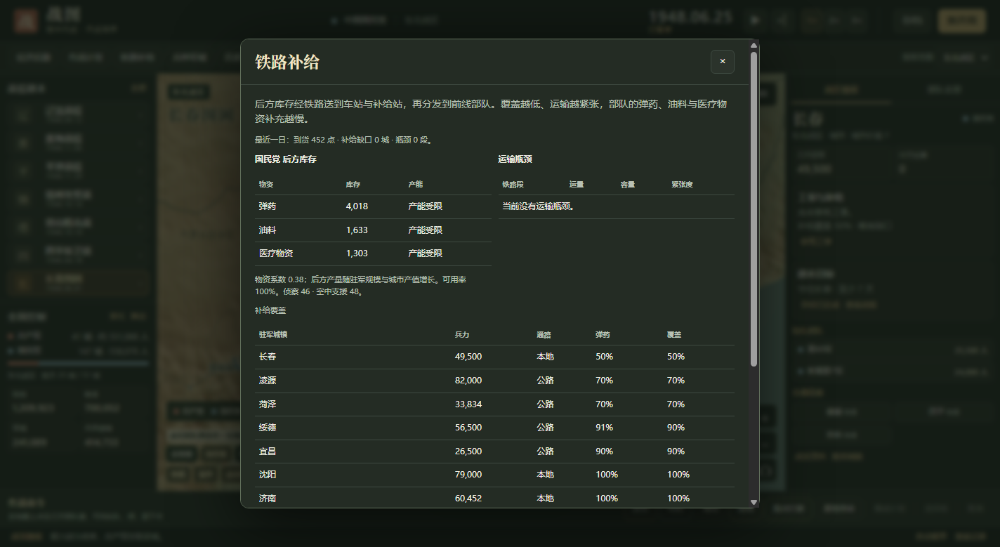

# 战图 · 国共内战

首次打开会强制进行锦州新手教程；完成后可在左侧选择 **1946 年 6 月 26 日全面内战爆发**，采用全国指挥范围。当前版本不读取或保存进度，刷新页面会重新开始。1945 年全国战局、辽沈等其他剧本仍可选择。

地图上的「势力范围」根据游戏城镇当前控制方及最近节点近似着色，距已有节点过远的地区不着色；这是随模拟变化的示意，并非精确历史疆界。「派系」图仅根据同阵营驻军推算地方派系，缺少驻军资料的区域沿用阵营颜色。可随时切换地形图、等高线和省界。

1946 年开局日期参考[中国共产党大事记·1946年](https://cpc.people.com.cn/GB/64162/64164/4416003.html)；开局兵力、各城镇归属和插值范围仍受游戏资料覆盖限制。

一款简体中文的**离线浏览器策略游戏**。地图与规则参考《钢铁雄心 IV》的兵团指挥、战线计划、铁路与公路后勤、工事建设与部队编制，界面、地图呈现与素材组织为原创设计。

- 时间范围：1945 年 8 月至 1951 年，可选日期开局，战局可推进到统一。
- 国共双方均可选，也可中途换边；统一目标可选「大陆」或「大陆及台湾」。
- 无需安装、无需联网即可玩；史料出处链接需要联网。

## 在线试玩

**https://wangzirui471-collab.github.io/zhantu-civil-war/**

打开网页即可开始，当前版本关闭存档，进度仅保留在当前页面，刷新或关闭页面后会丢失。如果所在网络访问 github.io 较慢，可克隆仓库后双击 `index.html`，或用下面的本地服务器在局域网内分享。

## 界面截图








## 主要功能

| 模块 | 说明 |
| --- | --- |
| 全国 / 战区双轨 | 全国 406 个城镇节点（铁路干线外也铺满县城）与战区指挥同步运行，可暂停、加速，随时换边。 |
| 地图下令 | 全国指挥可调度本方任一战区部队；对任一有陆路集结线的敌城下令，部队会经道路逐站推进，铁路路段更快。纵队、师、团均可独立下令。 |
| 地图兵种棋子 | 地图上显示步兵小人、炮兵炮组、装甲单位与舰艇；行军路线带移动单位，战斗出现步枪曳光、炮弹弹道与命中烟尘。 |
| 作战计划 | Ctrl / Shift 多选部队，选择作战决心（突击目标、守备战线、沿战线进攻、后撤至战线），指定目标与战线；统一预览后一键执行、暂停、撤销或委任司令员。 |
| 组织度与多日战役 | 部队牌底部显示组织度。战斗按日消耗组织度并有战斗宽度限制；进攻受挫后部队原地整补并结束当前命令，避免无休止自动重打。失去退路会被俘，断粮且士气崩溃的被围守军可能投降。战斗胜负与伤亡也会改变双方战争支持。天气、昼夜、战术、装甲穿甲、渡河、地形与多方向进攻都会影响每日结算。 |
| 国策与科研 | 6 条国策按天推进，完成后给出兵员、装备、组织度、空军、运输或工事等长期加成；6 条科技线（步/炮/装/后勤/医疗/航空）逐级解锁装备型号，装甲科技 1 级后开放装甲营。 |
| 生产与储备 | 装备产线生产步兵装备、火炮、装甲、航空与运输船；战斗缴获会补充对应枪炮库存。在己方城镇建设军工厂可提高产量、建设民用工厂增加财政；城镇详情可排队训练步兵、炮兵或机动部队。 |
| 师级编制设计器 | 营级模板（步兵/炮兵/装甲/摩托化/防空/反坦克 + 五类支援连）派生战斗宽度、攻防、装甲、穿甲、速度与补给，可保存多套并指派给部队。 |
| 将领与指挥 | 将领有特质与经验等级，所辖部队获得加成；指挥点可下强行军、死守、炮火准备三项技能。 |
| 空军与海军 | 顶部「空军指挥」「海军指挥」可直接进入。空军任务目前由全国机队统一执行，不能逐机或逐战区调遣；海军按海域部署护航、破交、巡逻与登陆准备，无法逐舰操作。海域与海路的对应为地理近似。登陆承受滩头惩罚并消耗船只。AI 会按战线计划推进、轰炸枢纽、为空投补给的被围部队提供支援，并组织登陆。 |
| 政治与战争支持 | 政治点可策反 / 劝降、整军、空运补给和动员；民心 / 战争支持受城镇易手、战斗胜负、伤亡与围城影响，并影响兵员增长。成功策反、围城投降及史实起义 / 和平改编会把部队及将领转入己方，低士气、低组织度的部队需要整编；可从历史事件中断开，改走动态推演。 |
| 情报、占领与外交 | 侦察提升情报、破坏打击敌方库存与机队，情报水平决定对敌军兵力的估计精度；占领城镇会积累抵抗，无人驻守时可能起义；法令（征兵/经济）与稳定度影响产出与科研。美国、苏联的援助、禁运、外交压力和调停会改变装备、空军与战争支持；日本仅作为东北历史遗留装备来源，不设战后主动援助。 |
| 后勤补给 | 「后方库存 → 铁路 / 公路车队 → 补给站 → 前线」，分算弹药、油料、医疗物资；被包围守军无法从全国粮仓直接领粮，会逐日缺粮、掉士气和组织度，可能投降。友军可沿有运输船的海路调动。铁路提升运力与速度，不是行军的前提。 |
| 工事与编制 | 驻军工兵修筑战壕、掩体、障碍、碉堡、固定炮位、补给站；按师团管理步兵、装甲、炮兵、工兵、医护、运输支援。 |
| 地形与行军 | 地图可切换地形、等高线和省界；省份/高程网格影响陆路行军时间与山地战斗防御。 |
| 战斗后果 | 战报列出双方伤亡、伤员（会回补）、俘虏、缴获步兵装备 / 火炮 / 装甲库存、士气 / 战争支持变化与老兵经验。 |
| 剧本与史料 | 30 个剧本入口及历史日期入口，含辽沈、锦州、塔山、四次四平、长春、淮海、平津；吴化文部、长春第60军 / 新编第7军、北平和平改编、陈明仁部队等史实节点可直接改变兵力归属，战役路线与城市说明附史料出处。新增入口标注「近似」：日期有来源，地名可能采用附近节点，兵力与部署尚未逐项复原，个别守军使用明确标注的模拟部队。 |
| 战况与存档 | 城镇易手简报、自动暂停、3／6／12 个月预测与两套方案并排比较；Ctrl+Z 撤销上一步。当前版本关闭读取和保存进度。 |

**新手教程与难度：**每次打开页面必须先完成锦州教程；由于当前不保存进度，刷新后需要重新学习。新开局可选普通、困难、魔鬼，对手战力分别为正常、+15%、+35%；换边后加成始终属于玩家对手。

## 本地运行

方式一：直接双击 `index.html`（Chrome / Edge 等现代浏览器）。

方式二：需要一个地址分享给别人时，用自带的静态服务器（需 Node.js）：

```bash
node scripts/serve.cjs 8099
```

终端会打印本机与局域网地址，例如 `http://192.168.1.8:8099/`。

## 开发与验证

```bash
node --test                        # 引擎、国策、科研、生产、编制、空军、海军、指挥、
                                   #   情报与占领、组织度与战役、补给、工事、政治、存档与时间线测试
node scripts/browser-smoke.cjs     # 无头 Chrome 浏览器冒烟测试（需本机安装 Chrome）
node scripts/playtest-100.cjs       # 100 局自动模拟（每局最多推进 14 天）
```

目录结构：

```
index.html          入口
engine.js           核心规则：命令、战斗、补给、工事、计划、经济
map.js              Canvas 地图绘制与交互
app.js              界面与面板
data.js             城市、部队、剧本、事件、史料
timeline.js         存档与时间线回放
save-store.js       IndexedDB 存档与 localStorage 迁移兼容
geography.js        高程与省界数据
style.css / command-room.css
portraits/          将领照片
tests/              自动测试
scripts/            本地服务器与浏览器冒烟测试
```

## 素材与史实说明

- 史料条目来自公开军史、档案说明与地方志，开局日期按主要事件或阶段近似设置。
- 地形与等高线依据 Mapzen 高程数据生成；海岸线与现代参照省界使用 Natural Earth 数据。
- 将领照片来自 Wikimedia Commons 等公开来源，逐张出处写在 `portraits.js` 的 `source` 字段中。
- 兵力、装备、补给、工事、士气等数值为游戏参数；铁路与公路补给是简化模型，地图上的运输瓶颈只表示运量紧张，不等同于史料中的实际运量。
- 游戏内的城市归属、兵力和战报包含推演结果，历史资料以各自出处为准。

## 版权

代码与界面为本项目原创。史实资料与照片的版权归各自来源所有，本项目仅用于非商业的历史题材展示；如需商用请先核对各来源的授权条款。

